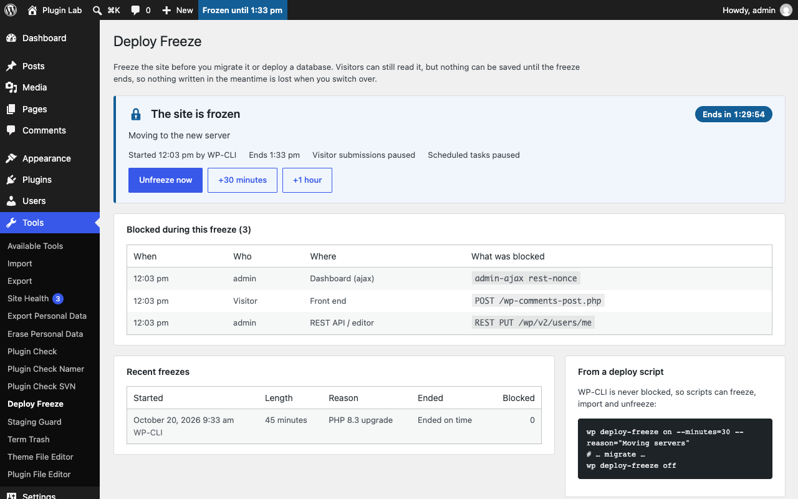
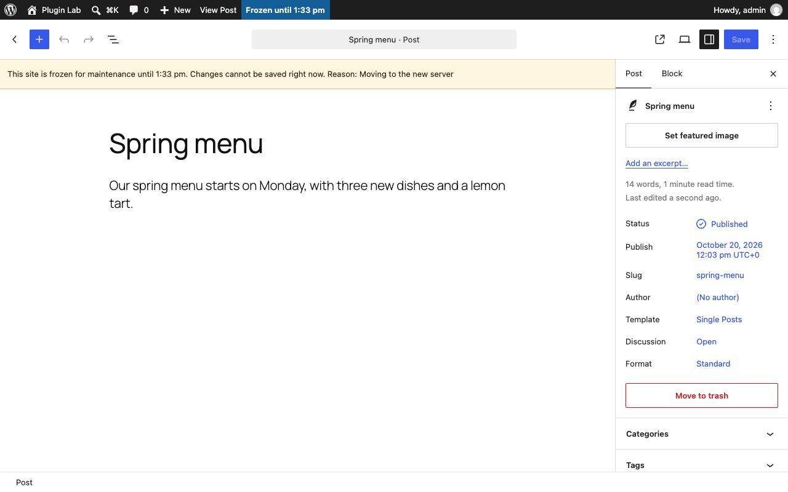
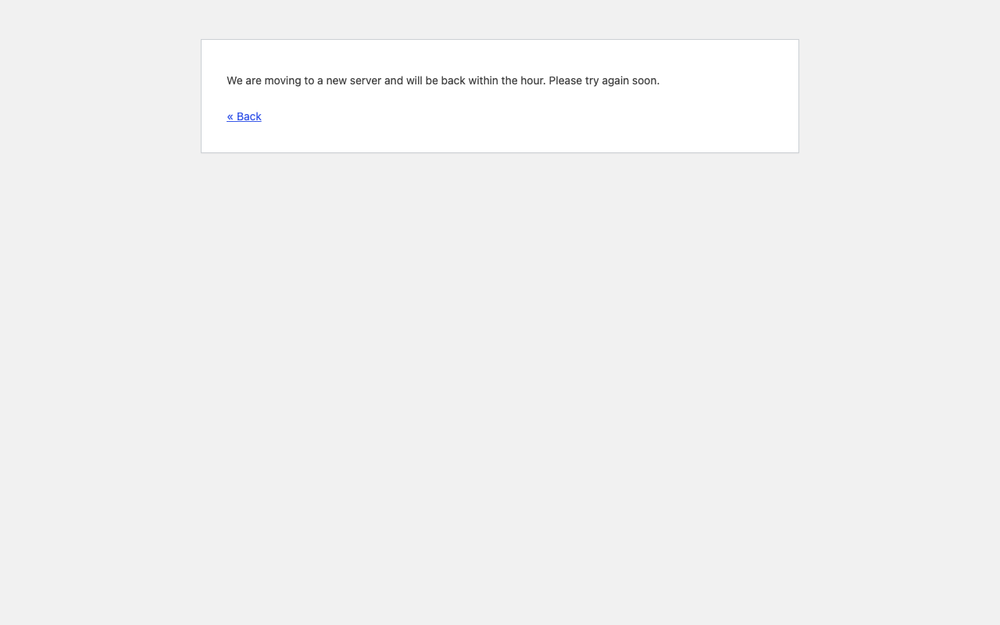

<h1 align="center">Deploy Freeze</h1>

<p align="center">
  <a href="https://playground.wordpress.net/?blueprint-url=https://raw.githubusercontent.com/aryanjasala/deploy-freeze/main/blueprint.json"></a>
  <a href="https://github.com/aryanjasala/deploy-freeze/releases/latest"></a>
  
  
  <a href="LICENSE.md"></a>
  <br>
  <a href="https://github.com/aryanjasala/deploy-freeze/actions/workflows/phpcs.yml"></a>
  <a href="https://github.com/aryanjasala/deploy-freeze/actions/workflows/phpstan.yml"></a>
  <a href="https://github.com/aryanjasala/deploy-freeze/actions/workflows/unit-tests.yml"></a>
  <a href="https://github.com/aryanjasala/deploy-freeze/actions/workflows/e2e-tests.yml"></a>
  <a href="https://github.com/aryanjasala/deploy-freeze/actions/workflows/plugin-check.yml"></a>
</p>

<p align="center">Read-only mode for migrations and deploys. Visitors still see the site, but nothing can be saved, so no edit, order or comment gets lost in the switch.</p>

<p align="center">
   Deploy Freeze during a freeze, with countdown and blocked attempts" width="880">
</p>

---

When you move a site to a new server, or replace the live database with one from staging, anything saved on the old copy during the move is lost. Maintenance mode hides the whole site. Deploy Freeze keeps it online and makes it read-only until you unfreeze, or until the freeze ends on its own.

## Features

- **wp-admin** still opens, but saves, uploads, settings and plugin changes are refused
- **Block editor** disables Save and Publish and says why, including for people who already have it open
- **REST and XML-RPC** writes get `423 Locked`. Reads still work
- **Visitors** posting comments, forms, checkouts or sign-ups get a `503` with `Retry-After` and your own message
- **WP-Cron** is held back and runs when the freeze ends
- **End time**, schedule, +30 minutes and +1 hour, and quick freeze from the admin bar
- **Blocked attempts** listed (who, when, what), and the last ten freezes kept
- Logging in always works, so an admin can always unfreeze

## Install

1. Download `deploy-freeze.zip` from the [latest release](https://github.com/aryanjasala/deploy-freeze/releases/latest).
2. In WordPress, go to **Plugins > Add New Plugin > Upload Plugin**, choose the zip and activate it.

Or with WP-CLI:

```sh
wp plugin install https://github.com/aryanjasala/deploy-freeze/releases/latest/download/deploy-freeze.zip --activate
```

Needs WordPress 6.6+ and PHP 7.4+. To try it first, the **Try in WordPress Playground** badge opens a throwaway WordPress in your browser with the plugin and some demo content.

## Quick look

WP-CLI is never blocked, so a deploy script can wrap the migration:

```sh
wp deploy-freeze on --minutes=30 --reason="Moving servers"
# ... migrate ...
wp deploy-freeze off
```

If the script dies halfway, the freeze still ends after 30 minutes.

## Screenshots

<table>
  <tr>
    <td width="50%" valign="top"><br><sub>The block editor during a freeze</sub></td>
    <td width="50%" valign="top"><br><sub>What visitors see when they send a form during a freeze</sub></td>
  </tr>
</table>

## Documentation

| Doc | What it covers |
| --- | --- |
| [Reference](docs/REFERENCE.md) | Constants, hooks, WP-CLI, what is blocked and what is stored |
| [Development](docs/DEVELOPMENT.md) | Local setup, commands and tests |
| [Contributing](docs/CONTRIBUTING.md) | Pull requests, required checks and PR titles |
| [Releasing](docs/RELEASING.md) | How merged pull requests become releases |
| [Security](docs/SECURITY.md) | Reporting a vulnerability |
| [readme.txt](readme.txt) | What WordPress.org shows, with the FAQ and changelog |

## Project structure

```
deploy-freeze.php        plugin header and PSR-4 autoloader
src/
├── Plugin.php           creates the services, guards load only while frozen
├── State.php            the saved freeze, its timing and messages
├── Freezer.php          starts, extends and ends freezes
├── BlockedLog.php       what the freeze stopped
├── History.php          the last ten freezes
├── Guards/              wp-admin, REST, front-end and cron guards
├── Admin/               freeze screen, notice, admin bar
├── Editor/EditorLock.php  locks the block editor through the heartbeat
└── Cli/Command.php      wp deploy-freeze
assets/                  editor lock and countdown scripts
tests/
├── Unit/                PHPUnit
└── e2e/                 Playwright specs and the Docker site
.wordpress-org/          screenshots
docs/                    reference, development, contributing, releasing
```

## License

[GPL-2.0-or-later](LICENSE.md) © Aryan Jasala
