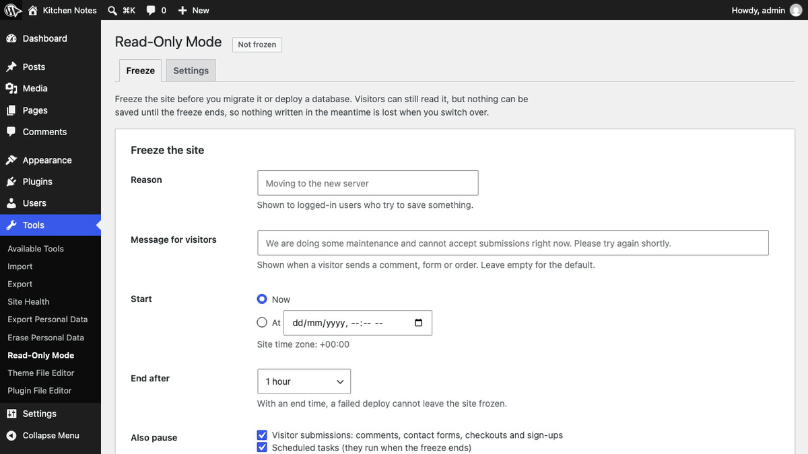
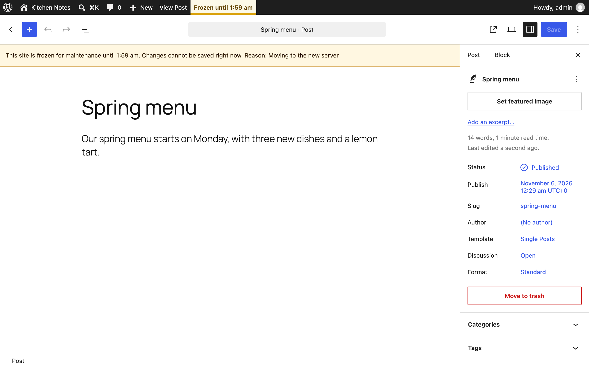
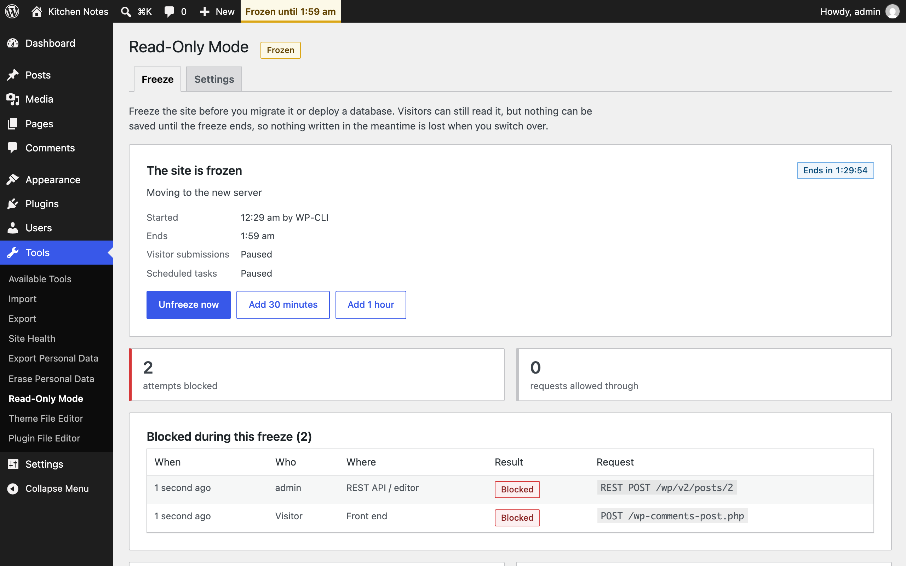
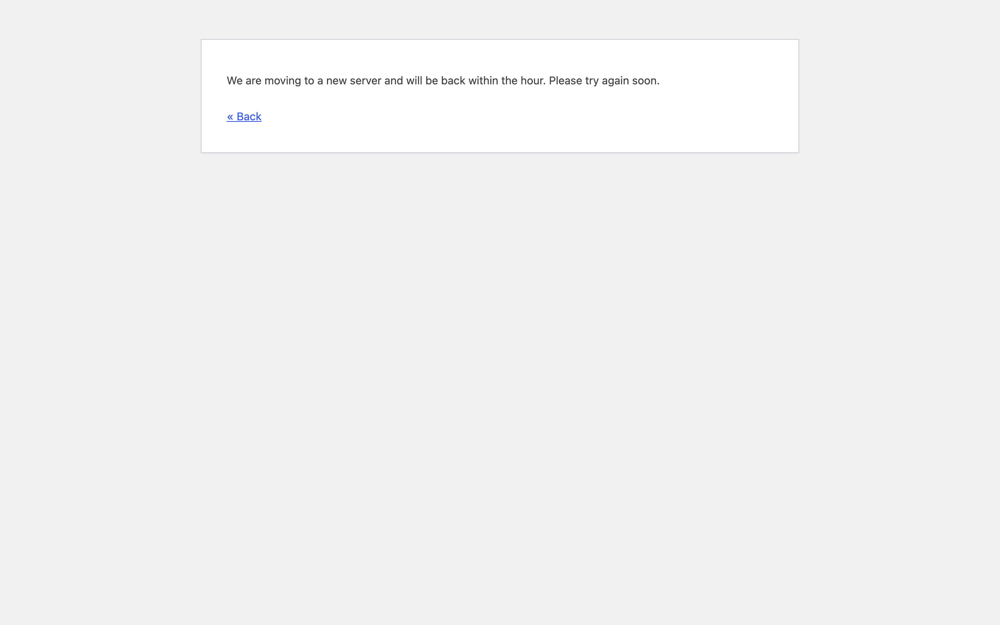
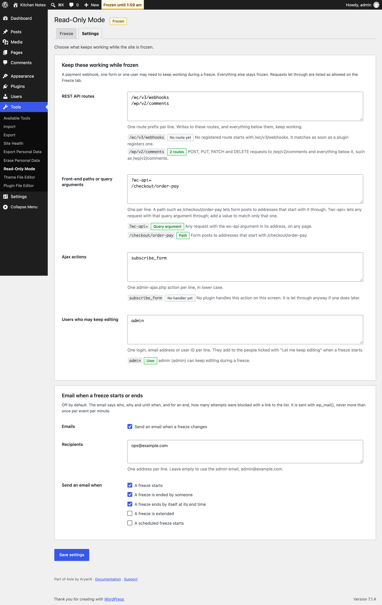

<p align="center"></p>

<h1 align="center">Axle Read-Only Mode</h1>

<p align="center">
  <a href="https://try.axlewp.com/axle-read-only-mode"></a>
  <a href="https://github.com/aryanjasala/axle-read-only-mode/releases/latest"></a>
  
  
  <a href="LICENSE.md"></a>
  <br>
  <a href="https://github.com/aryanjasala/axle-read-only-mode/actions/workflows/phpcs.yml"></a>
  <a href="https://github.com/aryanjasala/axle-read-only-mode/actions/workflows/phpstan.yml"></a>
  <a href="https://github.com/aryanjasala/axle-read-only-mode/actions/workflows/unit-tests.yml"></a>
  <a href="https://github.com/aryanjasala/axle-read-only-mode/actions/workflows/e2e-tests.yml"></a>
  <a href="https://github.com/aryanjasala/axle-read-only-mode/actions/workflows/plugin-check.yml"></a>
</p>

<p align="center">Read-only mode for migrations and deploys. Visitors still see the site, but nothing can be saved, so no edit, order or comment gets lost in the switch.</p>

<p align="center">
  
</p>

---

When you move a site to a new server, or replace the live database with one from staging, anything saved on the old copy during the move is lost. Maintenance mode hides the whole site. Axle Read-Only Mode keeps it online and makes it read-only until you unfreeze, or until the freeze ends on its own.

> [!NOTE]
> Free and open source under the GPL. No pro version, no upsells, no ads in wp-admin, no tracking. And it stays that way.
>
> Part of [Axle](https://axlewp.com/) by AryanX, a family of free plugins for running WordPress sites safely.

## Features

- **Check before freezing**: a "Before you freeze" card shows who has a post open in the editor, scheduled posts and tasks due during the freeze, and WooCommerce orders waiting for payment. It updates as you change the length, start or scope, and it only informs
- **Freeze part of the site**: Everything (the default), Content only (settings, plugins, themes and updates keep working) or Settings and code only (editors and visitors keep working)
- **wp-admin** still opens, but saves, uploads, settings and plugin changes are refused
- **Block editor** disables Save and Publish and says why, including for people who already have it open
- **REST and XML-RPC** writes get `423 Locked`. Reads still work
- **Visitors** posting comments, forms, checkouts or sign-ups get a `503` with `Retry-After` and your own message
- **WP-Cron** is held back and runs when the freeze ends
- **End time**, schedule, +30 minutes and +1 hour, and quick freeze from the admin bar
- **Allow-list**: keep a payment webhook, one form, a REST route, an AJAX action or a user working during a freeze, with suggestions for WooCommerce, Stripe and Gravity Forms. Requests let through are logged as allowed
- **Multisite**: freeze the whole network or chosen sites from Network Admin, while each site can still freeze itself. A network freeze shows as "frozen by the network" on every site
- **Email** when a freeze starts, ends, ends by itself, is extended or a scheduled freeze starts. Off by default
- **Site Health** check for a freeze that ran past its end time, has no end after 6 hours, or is forced by wp-config.php
- **Blocked attempts** listed (who, when, what), and the last ten freezes kept
- Logging in always works, so an admin can always unfreeze

## Install

1. Download `axle-read-only-mode.zip` from the [latest release](https://github.com/aryanjasala/axle-read-only-mode/releases/latest).
2. In WordPress, go to **Plugins > Add New Plugin > Upload Plugin**, choose the zip and activate it.

Or with WP-CLI:

```sh
wp plugin install https://github.com/aryanjasala/axle-read-only-mode/releases/latest/download/axle-read-only-mode.zip --activate
```

Needs WordPress 6.6+ and PHP 7.4+. To try it first, [try.axlewp.com/axle-read-only-mode](https://try.axlewp.com/axle-read-only-mode) opens a private WordPress in your browser with the latest release and some demo content. Nothing to install.

## Quick look

WP-CLI is never blocked, so a deploy script can wrap the migration:

```sh
wp axle-read-only-mode on --minutes=30 --reason="Moving servers"
# ... migrate ...
wp axle-read-only-mode off
```

If the script dies halfway, the freeze still ends after 30 minutes.

## Screenshots

<table>
  <tr>
    <td width="50%" valign="top"><br><sub>The block editor during a freeze</sub></td>
    <td width="50%" valign="top"> Read-Only Mode during a freeze, with countdown and blocked attempts"><br><sub>Tools > Read-Only Mode during a freeze, with countdown and blocked attempts</sub></td>
  </tr>
  <tr>
    <td width="50%" valign="top"><br><sub>What visitors see when they send a form during a freeze</sub></td>
    <td width="50%" valign="top"> Read-Only Mode > Settings, with the allow-list and the email choices"><br><sub>Tools > Read-Only Mode > Settings, with the allow-list and the email choices</sub></td>
  </tr>
</table>

## Documentation

| Doc | What it covers |
| --- | --- |
| [Reference](docs/REFERENCE.md) | Constants, hooks, WP-CLI, what is blocked and what is stored |
| [Development](docs/DEVELOPMENT.md) | Local setup, commands and tests |
| [Contributing](docs/CONTRIBUTING.md) | Pull requests, required checks and PR titles |
| [Releasing](docs/RELEASING.md) | How merged pull requests become releases |
| [Security](docs/SECURITY.md) | Reporting a vulnerability |
| [readme.txt](readme.txt) | What WordPress.org shows, with the FAQ and changelog |

## Project structure

```
axle-read-only-mode.php        plugin header and PSR-4 autoloader
src/
├── Plugin.php           creates the services, guards load only while frozen
├── State.php            the saved freeze, its timing and messages, and the network freeze over it
├── Freezer.php          starts, extends and ends freezes
├── Scopes.php           the scopes and the rules that sort a request into content or code
├── Checks.php           the Before you freeze checks
├── BlockedLog.php       what the freeze stopped and what the allow-list let through
├── History.php          the last ten freezes
├── Settings.php         the allow-list and email settings
├── AllowList.php        checks, matches and describes allow-list entries
├── Notifier.php         emails when a freeze starts or ends
├── Network.php          the network's freeze, history and log
├── Guards/              wp-admin, REST, front-end and cron guards
├── Admin/               freeze screen, settings tab, network screen, notice, admin bar
├── Health/SiteHealth.php  Site Health test and info section
├── Editor/EditorLock.php  locks the block editor through the heartbeat
└── Cli/Command.php      wp axle-read-only-mode
assets/                  editor lock, screen script and shared styles
tests/
├── Unit/                PHPUnit
├── e2e/                 Playwright specs and the Docker site
└── e2e-multisite/       Playwright specs and a Docker multisite network
.wordpress-org/          screenshots
docs/                    reference, development, contributing, releasing
```

## More free plugins

Small plugins that each fill one gap in WordPress, all free with no pro version. Try them all together at [demo.axlewp.com](https://demo.axlewp.com/).

| | Plugin | What it does |
| --- | --- | --- |
|  | [Axle Page Template Usage](https://github.com/aryanjasala/axle-page-template-usage) | See which template every page uses, and fix the pages on a missing template |
|  | [Axle Staging Guard](https://github.com/aryanjasala/axle-staging-guard) | Stops staging copies from emailing real people or getting indexed |
|  | [Axle Category & Tag Trash](https://github.com/aryanjasala/axle-category-tag-trash) | A trash for categories, tags and custom terms, with undo and full restore |
|  | [Axle Block Restore](https://github.com/aryanjasala/axle-block-restore) | Restore a single block from an old revision, not the whole post |
|  | [Activity Log with Undo](https://github.com/aryanjasala/activity-log-with-undo) | An activity log where every change you can reverse has an Undo button |
|  | [Agent Governance](https://github.com/aryanjasala/agent-governance) | Hold risky AI agent calls for approval, preview what they change, and roll back a session |
|  | [Axle AI Guard](https://github.com/aryanjasala/axle-ai-guard) | See and control every AI call your plugins make: cost, data sent, budgets and a kill switch |
|  | [Axle Config Sync](https://github.com/aryanjasala/axle-config-sync) | Keep settings in git, diff them against the live site, apply with a preview and undo |
|  | [Axle Leftovers](https://github.com/aryanjasala/axle-leftovers) | Find what deleted plugins left behind, see who owns it and why, and clean it up with undo |
|  | [Axle License Tracker](https://github.com/aryanjasala/axle-license-tracker) | See which premium plugins are licensed, which lapsed and stopped getting updates, and what renews when |
|  | [Axle Review](https://github.com/aryanjasala/axle-review) | Share drafts through private links and collect outside feedback as block Notes |
|  | [Axle Runtime Doctor](https://github.com/aryanjasala/axle-runtime-doctor) | Check OPcache coverage, the object cache, PHP support and limits, cron and more, with the fix for your host |
|  | [Axle Smoke Test](https://github.com/aryanjasala/axle-smoke-test) | Check key pages after every update or deploy, see what broke and roll it back |
|  | [Block Doctor](https://github.com/aryanjasala/block-doctor) | Scan the whole site for invalid and broken blocks and fix them in bulk, with undo |
|  | [Block Theme Ops](https://github.com/aryanjasala/block-theme-ops) | Find Site Editor changes that override your theme files, see the diff, reset them or send them to Git |
|  | [Role Right-Sizer](https://github.com/aryanjasala/role-right-sizer) | Recommends the smallest role each user needs, from what they actually do |
|  | [Update Rehearsal](https://github.com/aryanjasala/update-rehearsal) | Try plugin, theme, core and PHP updates on a disposable copy of your site in WordPress Playground first |
|  | [User Session Manager](https://github.com/aryanjasala/user-session-manager) | See every device signed in, sign out one, and limit sessions per role |

## License

Copyright Aryan Jasala. Licensed under [GPL-2.0-or-later](LICENSE.md).
